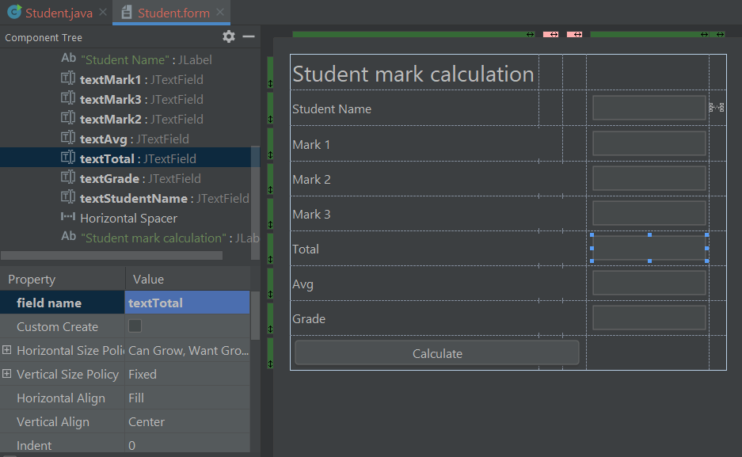

# StudentsMarks

A small Java Swing desktop form that takes a student's name and three marks, then shows the total, the average and a Pass/Fail result (pass if the average is above 50). Written as an introductory Java GUI exercise.

| Input form | Result |
|:---:|:---:|
|  |  |

## Implementation

- `src/Student.java`: event handler for the **Calculate** button and the `main` method
- `src/Student.form`: layout created with the IntelliJ IDEA GUI Designer

## Running

The form layout is compiled from `Student.form` by IntelliJ IDEA's GUI Designer, so open the project in IntelliJ IDEA and run `Student.main`. Compiling `Student.java` with plain `javac` will not bind the form fields.

## Known issues

- The average uses integer division (`tot / 3`), so fractional averages are truncated.
- Non-numeric input throws an unhandled `NumberFormatException`.

## Author

**S M Mahamudul Hasan** · [GitHub](https://github.com/hasansust32)
